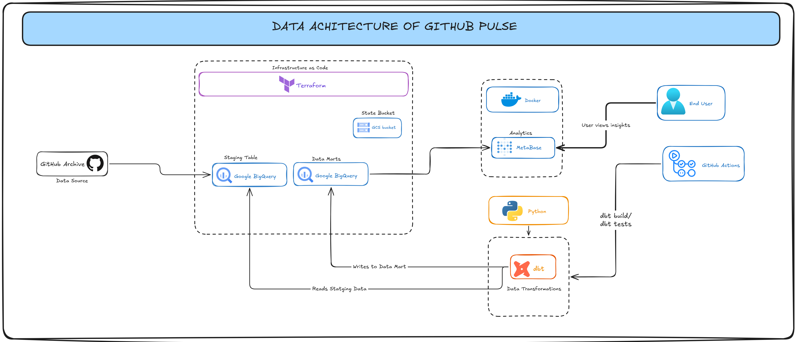

# github-pulse



> **A cloud data warehouse analytics project** exploring 5 years (2020–2024)
> of public GitHub activity — ~15 billion events, modeled dimensionally in
> BigQuery, visualized as a Year-in-Review dashboard in Metabase.


---

## What this is

github-pulse answers one question: **what did the open-source world actually
look like each year from 2020 to 2024?**

The deliverable is a **Year-in-Review dashboard** ; pick a year, see the
breakout repos, top contributors, biggest star moments, bot-vs-human activity
patterns, and month-by-month insights. 


## By the numbers

| Metric | Value |
| --- | --- |
| Events processed | ~15 billion |
| Date range covered | 2020-01-01 → 2024-12-31 |
| Raw data scanned (one-time backfill) | ~5 TiB |
| Staging tables | 4 |
| Mart tables (planned) | 2 fact + 3 dimension (star schema) |
| Final storage footprint | ~200 GB (will drop to ~20 GB post-cleanup) |
| **Build cost (out of pocket)** | **$0** (fully covered by GCP free trial credits) |
| **Ongoing monthly cost** | **~$4** (will drop to ~$0.15 after cleanup) |

## The stack

| Layer | Tool | Why |
| --- | --- | --- |
| Cloud warehouse | **BigQuery** | GH Archive already hosted there (free); serverless; generous free tier |
| Transformations | **dbt** (dbt-bigquery adapter) | Industry standard for SQL-based analytics engineering |
| Infrastructure as code | **Terraform** | Datasets, IAM, budgets, (optional) hosted Metabase — all declarative |
| Dashboard | **Metabase** (self-hosted via Docker) | Open-source, dashboard JSON is version-controllable |
| CI/CD | **GitHub Actions** | PR checks for dbt + Terraform |

See [`docs/architecture.md`](docs/architecture.md) for the full component
breakdown.

## Repository structure

```
gh-pulse/
├── README.md                 # you are here
├── infra/                    # Terraform (reference implementation)
├── dbt/                      # dbt project — sources, staging, marts
├── metabase/                 # dashboard definitions (JSON) + local docker-compose
├── scripts/                  # bootstrap, backfill, cost-check helpers
├── docs/
│   ├── architecture.md       # system overview + diagrams
│   ├── data_model.md         # dimensional model walkthrough
│   ├── raw-data-eda.md       # data quality checks to run on the raw tables
│   ├── runbook.md            # how to reproduce / run locally
│   ├── cost_report.md        # honest spend summary
│   └── decisions/            # ADRs (numbered, one per real decision)
└── .github/
    └── workflows/            # dbt-ci.yml, terraform-ci.yml
```

## Key design decisions

Rather than hide the tradeoffs this project navigated, they live in
[`docs/decisions/`](docs/decisions/) as Architecture Decision Records (ADRs).
Reading these is probably the best way to evaluate the engineering judgment
behind the code:

- **[ADR 0001](docs/decisions/0001-why-bigquery.md)** — Why BigQuery and not Snowflake, Databricks, or DuckDB
- **[ADR 0002](docs/decisions/0002-pre-aggregate-at-staging.md)** — Why staging aggregates on the way in, not event-level
- **[ADR 0003](docs/decisions/0003-use-metabase-selfhosted.md)** — Why Metabase (and self-hosted) over Looker/Superset/Tableau
- **[ADR 0005](docs/decisions/0005-skip-payload-extraction.md)** — Why PR-detail queries were cut mid-backfill
- **[ADR 0006](docs/decisions/0006-two-fact-tables-not-one.md)** — Why two fact tables sharing dimensions, not one atomic fact

Each ADR explains the context, the alternatives considered, the decision, and
the consequences. The pattern is deliberate — real engineering is a sequence
of tradeoffs, not a straight line.

## Data quality

Before trusting any model, the raw tables get checked for duplicates, grain
violations, repo renames, bots that slip past the `[bot]` filter, and gaps in
the daily series. The queries, what each one finds and where each fix belongs
are in [`docs/raw-data-eda.md`](docs/raw-data-eda.md).

## Data model (preview)

A classic Kimball-style dimensional model with two fact tables sharing
conformed dimensions:

```
                            dim_dates
                                │
                                │
dim_actors ─── fct_daily_actor_events        fct_daily_repo_events ─── dim_repos
                                                    │
                                                    │
                                                dim_event_types
```

Full walkthrough — including the derivation from business questions to grain
to tables — in [`docs/data_model.md`](docs/data_model.md).

## What this project is NOT

Being clear about scope matters more than being flashy:

- **Not real-time** — data covers 2020–2024, batch-loaded once
- **Not Spark/Hadoop** — this is "medium data" (hundreds of GB), BigQuery handles it serverlessly

## Running locally

Setup takes ~15 minutes once you have a GCP account with BigQuery enabled.
Full step-by-step in [`docs/runbook.md`](docs/runbook.md).

Quick preview:

```bash
# 1. Clone
git clone https://github.com/<you>/gh-pulse.git && cd gh-pulse

# 2. GCP setup (new project, link billing, enable BigQuery API)
#    See docs/runbook.md for the full checklist

# 3. Install dbt
python -m venv .venv && source .venv/bin/activate
pip install dbt-bigquery

# 4. Configure dbt
cp dbt/profiles.yml.example dbt/profiles.yml
# edit profiles.yml with your project ID + service account key path

# 5. Run the models (once marts are built)
cd dbt && dbt build

# 6. Launch Metabase locally
cd metabase && docker-compose up
# → open http://localhost:3000, connect to BigQuery, import year_in_review.json
```

## Cost transparency

A full breakdown lives in [`docs/cost_report.md`](docs/cost_report.md). TL;DR:

- **Build phase:** $7.75 of actual BigQuery usage, fully absorbed by $300 GCP
  free trial credits. Net out-of-pocket: **$0.00**.
- **Steady state (today):** ~$4/month, almost entirely from storing the raw
  staging tables.
- **Steady state (post-cleanup):** ~$0.15/month, well inside the permanent
  free tier.

The project uses GCP's permanent free tiers (1 TiB queries + 10 GiB storage
per month) plus a $25/month budget alert with four thresholds as the backstop.

## Credits & attribution

- Raw data: [GH Archive](https://www.gharchive.org) by Ilya Grigorik — a
  genuinely remarkable public resource.
- Dimensional modeling methodology: Ralph Kimball, _The Data Warehouse Toolkit_.
- Analytics engineering patterns: the dbt community.

